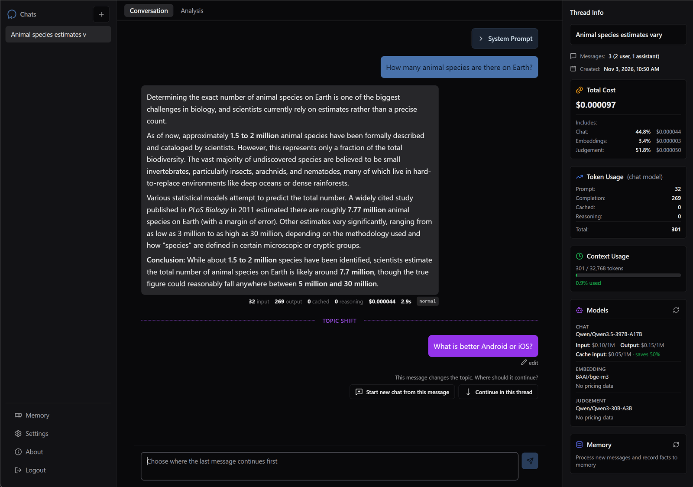
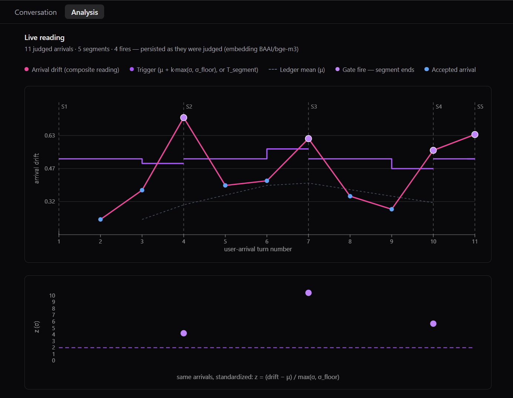
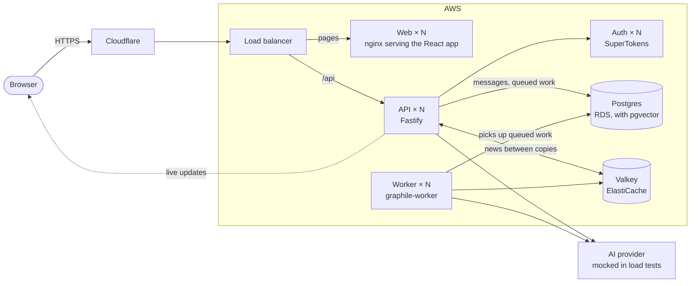

# Ari

Ari is a chat app for talking to AI models, built to run on your own
hardware. It shows what every reply costs, notices when you change the
subject, and, if you let it, remembers what matters about you for your next
conversation. Everything except the AI model itself runs on your own
machines, so your conversations stay yours.



## What It Does

- **Chat** — Replies appear as they are written. Keep several conversations
  (Threads), edit a message, or ask for a reply again.
- **Notices a change of subject** — Before it replies, Ari checks whether
  your message still belongs in the conversation. If it doesn't, Ari pauses
  and asks whether you'd like to start a new Thread. The check is maths
  rather than an AI's opinion. A topic is tracked as a series of embedding
  vectors with a centre of gravity, and each new message is measured by its
  cosine distance from that centre. A message more than two standard
  deviations beyond what is normal for the topic counts as a change of
  subject, and a second, slower check catches gradual drift. Every verdict is
  stored with the numbers it was judged on.
- **Shows the cost** — What each reply costs in tokens and US dollars, with a
  running total for every Thread.
- **Caps the spending** — A hard daily limit on what the whole deployment can
  spend on the AI model.
- **Memory (opt-in)** — When a topic ends, Ari notes facts about you from your
  own words, and new Threads start with them. You can see, edit and remove
  them.
- **Accounts** — Email and password sign-in, and each person sees only their
  own Threads.

The Analysis tab shows how the topic check judged each message: each
message's distance from the topic, the line it had to cross, and where it
caught a change of subject.



## How It Fits Together

The diagram shows aws-prod, the scaled-out deployment the load tests run
against. Each service there runs in as many copies as the load needs.



The API answers requests and keeps a live connection open to each browser
tab. Work that can take a while, such as checking a message's topic,
titling a Thread or capturing Facts, goes on a queue in Postgres, and the
worker picks it up. When the worker finishes, the API copy holding that
user's connection hears about it through Valkey and tells the browser.

At home everything is smaller. The API and the worker run as one process, so
their news stays inside it and there is no Valkey. Cloudflare reaches the
home server through a tunnel rather than a load balancer, and nginx passes
`/api` on to the backend.

## Tech Stack

| Layer | Technology |
|---|---|
| Frontend | React, React Router, Vite, Tailwind, TypeScript |
| Backend | Node.js, Fastify, Kysely, TypeScript |
| Database | PostgreSQL with pgvector |
| Background work | graphile-worker (in Postgres) |
| Live updates | Server-sent events, with Valkey between backend copies |
| Auth | SuperTokens (self-hosted) |
| AI | Vercel AI SDK, with DeepInfra as the provider |
| Home deployment | Docker Compose behind a Cloudflare Tunnel |
| AWS deployment | CDK (ECS Fargate, RDS, ElastiCache, load balancer); Terraform for Cloudflare |
| Load testing | Own harness: virtual users on Fargate Spot, results judged from CloudWatch and the app's own records |
| Checks | Vitest, Biome, knip, dependency-cruiser, Lefthook |

## Testing

Tests run against a real Postgres, not mocks. How to run them is in
[the setup guide](docs/setup.md#running-the-tests).

Load runs drive aws-prod, or a home deployment, with virtual users from
`load/`. Each run is sealed into a folder of records and judged against
targets fixed when it starts. The largest so far held 50,000 signed-in users,
10,000 of them chatting, without a failed request. What each run found is in
[the load run learnings](docs/architecture/load-run-learnings.md).

## Running It

Development, staging and production at home run on Docker Compose, and
aws-prod is raised from code for load tests. The steps, configuration and
test setup are in [the setup guide](docs/setup.md).

## Project Structure

```
├── frontend/   React app
├── backend/    API, background worker, mock inference server
├── lib/        The API contract and metrics shared by every app
├── load/       Load harness: virtual users, run records, verdicts
├── infra/      aws-prod: CDK stacks, Terraform for Cloudflare, operator scripts
├── scripts/    Repository checks
├── adrs/       Architecture decisions
├── docs/       Flows, architecture, maths, ideas
├── .pi/        Agent skills
└── CONTEXT.md  Domain vocabulary
```

## Documentation

- **[Setup guide](docs/setup.md)** — Running Ari at home, configuring it, and running its tests
- **[Domain vocabulary](CONTEXT.md)** — The terms (Threads, Turns, Drift, Facts, Seeds, Handovers) the codebase assumes everywhere
- **[Architecture decisions](adrs/)** — Why the key technical choices were made
- **[A new message in a Thread](docs/flows/new-message.md)** — Submit, Drift gate, Retry, pause and Handover, end to end
- **[Background work](docs/flows/background-work.md)** — The queue, the event bus, push to the browser, and how failures surface
- **[Drift maths](docs/maths/)** — How the Drift gate judges a message, and how it keeps running totals
- **[aws-prod architecture](https://amg.github.io/ariadne/architecture/aws-prod-architecture.html)** — The multi-copy AWS deployment: services, the way in, why Valkey
- **[Load testing architecture](https://amg.github.io/ariadne/architecture/load-testing-architecture.html)** — How a load run is driven, recorded and judged
- **[What the load runs taught us](docs/architecture/load-run-learnings.md)** — What strained in each run, and the fix

## The Name

Ari is short for Ariadne. In the Greek myth, she gave Theseus a ball of
thread so he could find his way back out of the labyrinth. Ari's
conversations are Threads too. It notices when one wanders off its topic,
and its memory helps you find your way back.
