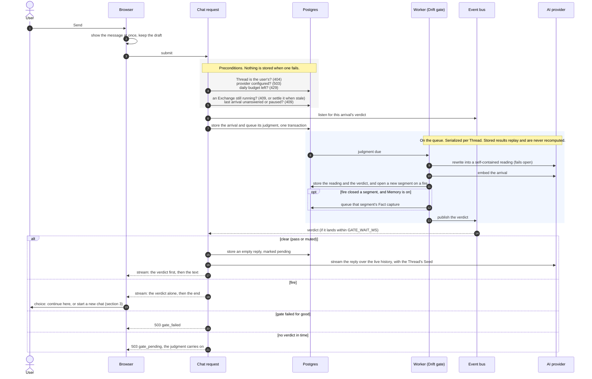
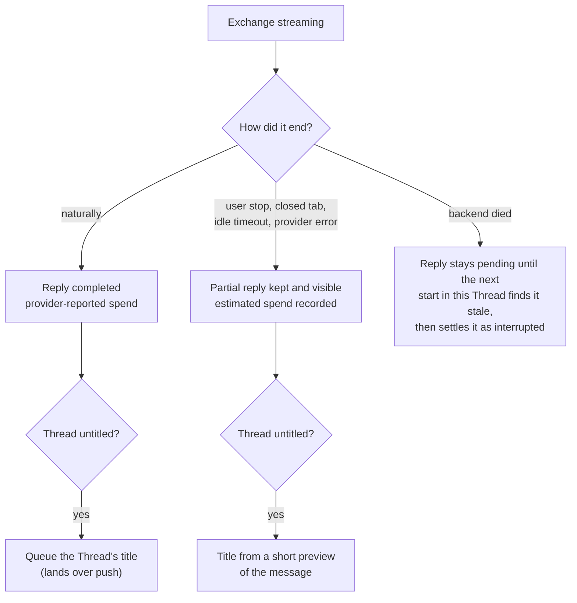
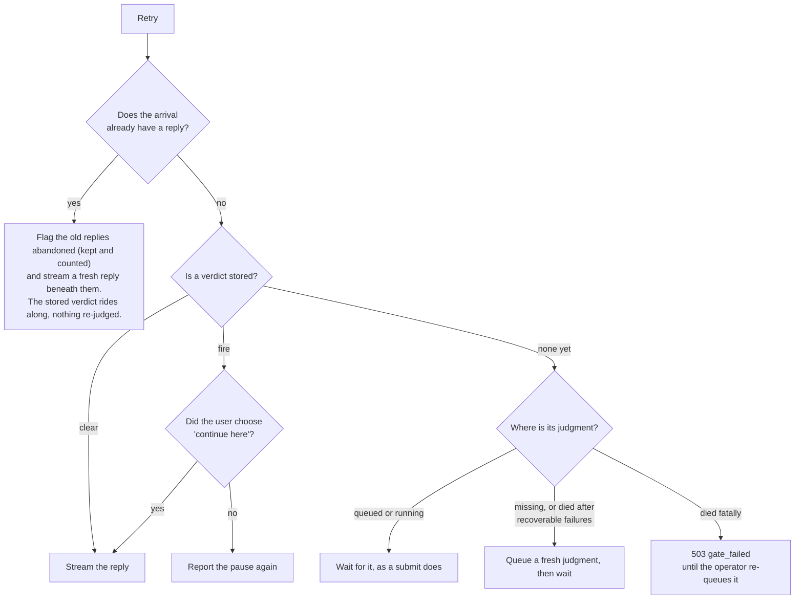
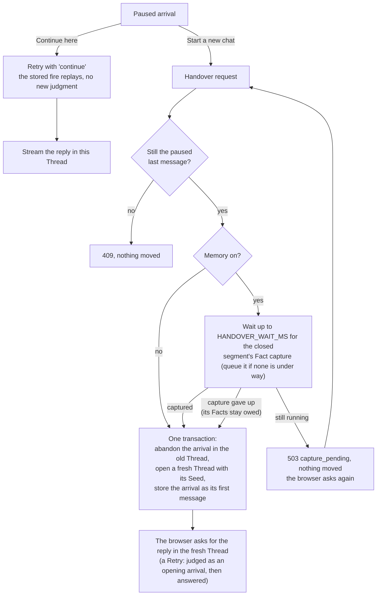

# A new message in a Thread

What happens, end to end, when the user sends a message into a Thread:
what the request does itself, what it hands to the queue, and how each
possible outcome reaches the user. The code is the source of truth.
This page is the map for reading it.

How the queue, the event bus and push work, and the full list of
failure answers, is covered in [BACKGROUND-WORK.md](BACKGROUND-WORK.md).
How the Drift gate judges an arrival is covered in ADR 0006, ADR 0007
and `docs/ideas/THREAD-DRIFT-MATH.md`. Terms are defined in `CONTEXT.md`.

## 1. Submit: store, judge, then answer

The one rule behind this flow is that **no reply is generated for an
arrival the Drift gate has not judged.** The request stores the arrival,
hands its judgment to the queue, and waits a short while for the
verdict. That verdict decides whether this same response becomes a
streamed reply, a pause, or a polite "still checking".

When the request answers `gate_pending` or `gate_failed`, the message
stays where it is. It is stored, just not answered yet. The verdict
arrives over push, and the user's Retry then picks up from wherever the
arrival stands (section 2).

### How an Exchange ends

Every Exchange settles, whether it finished cleanly or not, and its
spend is always recorded.

Nothing that ends an Exchange early abandons anything. The message and
the partial reply stay in the Thread, and the partial text is part of
the context for whatever comes next.

## 2. Retry: the last live arrival decides

Retry, the regenerate trigger, is server-authoritative. It always
targets the newest live user message, so an arrival that was handed
over to another Thread is never revived. It passes the same
preconditions as a submit first, the daily budget included, so an
exhausted budget stops it before any judgment or reply. What happens
next depends on where that arrival stands.

**Edit** follows the same path. It abandons the old arrival and every
reply grown from it (all kept and counted), stores the edited text as a
fresh arrival with its own queued judgment, and the Retry that follows
waits on that judgment like any submit. Because the fresh arrival is
judged anew, it may pause again.

## 3. After a pause: continue here, or start a new chat

The move is all-or-nothing. The arrival lives in exactly one Thread at
any moment, and only one Handover can win.

## 4. Fact capture (background, Memory on)

A segment owes capture once it has settled, either because a drift fire
closed it or because a Handover took its arrival away. Memory keeps a
pointer for each segment that marks how far capture has read. Each pass
extracts Facts only from the Turns past that pointer, and older Turns
go to the model as context only. Every candidate Fact outside the
user's blocked categories is checked against near neighbours, so the
same Fact is not stored twice.

The pointer moves only when a pass succeeds. A failed pass leaves the
debt owed, the queue retries it, and if the capture gives up the debt
is still there for the next pass to pick up. ADR 0010 covers the full
reasoning.
