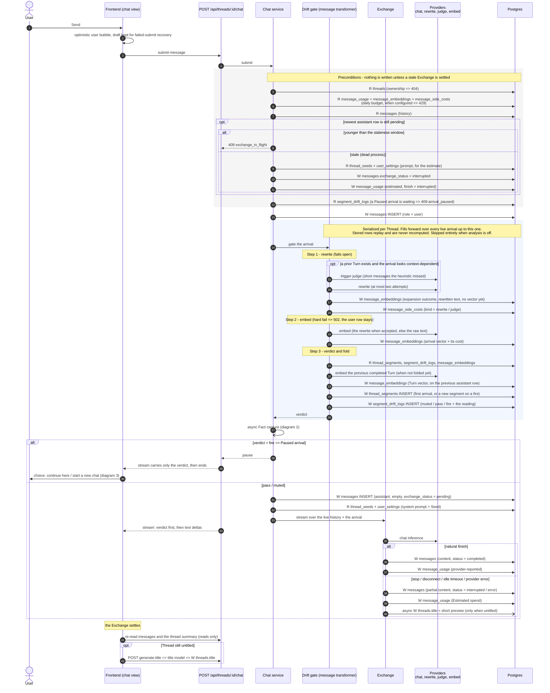
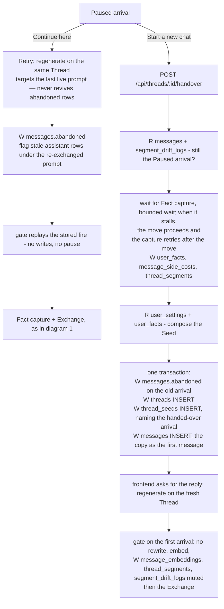

# A new message in a Thread

What happens, end to end, when the user sends a message into an existing
Thread: which actions run in the request, what is kicked off beside it,
and which tables each step writes. The code is the source of truth; this
page is the map for reading it.

**Legend.** **W** = write, **R** = read, *async* = runs in the
background, outside the request.

## 1. Submit → gate → Exchange

The request does three things in order: it checks the Thread may take a
message, stores the arrival and runs the Drift gate on it, and then
either pauses or starts the Exchange. Fact capture is kicked off beside
the request as soon as the gate has judged.



## 2. Fact capture (background)

Kicked off after every gate pass, serialized per Thread, and it never
fails the request. A segment owes capture once it is settled — a live
drift fire judged into it, or a cut onto it whose fire was handed over.
Each pass reads only the Turns past the pointer Memory keeps for the
segment (`memory_capture_progress.captured_through_at`), with older
Turns sent to the model as context only. A failure leaves the pointer
put, so the debt stays owed and the next pass picks it up;
checkpointing keeps the repeat bounded.

```mermaid
sequenceDiagram
  participant M as Fact capture
  participant P as Providers<br/>memory model, embed
  participant DB as Postgres

  M->>DB: R thread_segments join segment_drift_logs<br/>(settled anchors past the capture pointer)
  alt nothing owed
    M-->>M: done
  else memory is off (R user_settings)
    M->>DB: W memory_capture_progress<br/>(advance past the owe, nothing gathered)
  else for each owed segment
    M->>DB: R messages (the segment's new Turns; the old ones are context)
    M->>P: extract Fact candidates
    loop each candidate outside the blocked categories
      M->>P: embed the candidate
      M->>DB: R user_facts (nearest neighbours)
      opt a near neighbour exists
        M->>P: duplicate check
      end
      M->>DB: W user_facts INSERT (when new)
    end
    M->>DB: W message_side_costs, additive<br/>(fact_extraction / fact_duplicate_check / fact_embedding,<br/>recorded on the settle row)
    M->>DB: W memory_capture_progress<br/>(advance to the settle row — on success only;
 a failure leaves the pointer where it was.
 The next path over the thread picks up the debt.)
  end
```

## 3. After a pause



## Which tables each action writes

| Table | Submit, pass | Submit, fire | Fact capture | Handover | After settle |
|---|---|---|---|---|---|
| `messages` | user + assistant rows; content, status | user row | — | abandon the old arrival, insert the copy | — |
| `message_usage` | one row, reported or estimated | — | — | — | — |
| `message_embeddings` | arrival row + the previous Turn's row | same | — | via the fresh Thread's first reply | — |
| `message_side_costs` | rewrite / judge | rewrite / judge | fact spend, additive | via capture | — |
| `thread_segments` | first segment only | a new segment | — | via capture | — |
| `memory_capture_progress` | — | — | pointer advance | via capture | — |
| `segment_drift_logs` | one verdict | one verdict (fire) | — | — | — |
| `user_facts` | — | — | new Facts | via capture | — |
| `threads` | title, only when interrupted and untitled | — | — | the fresh Thread | title (generate-title) |
| `thread_seeds` | — | — | — | one row | — |
