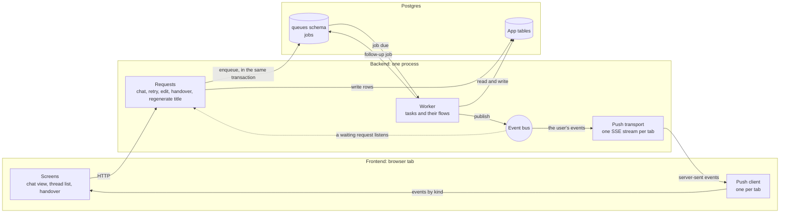
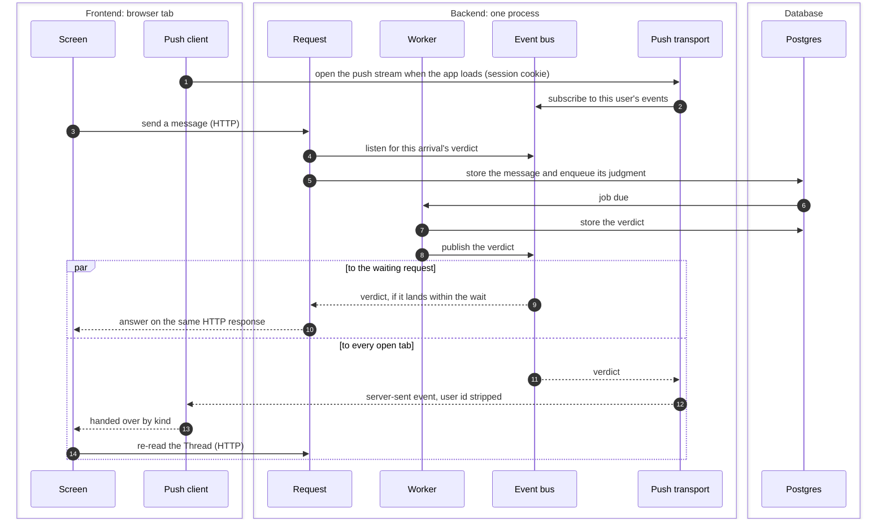
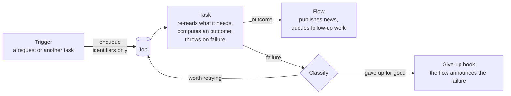
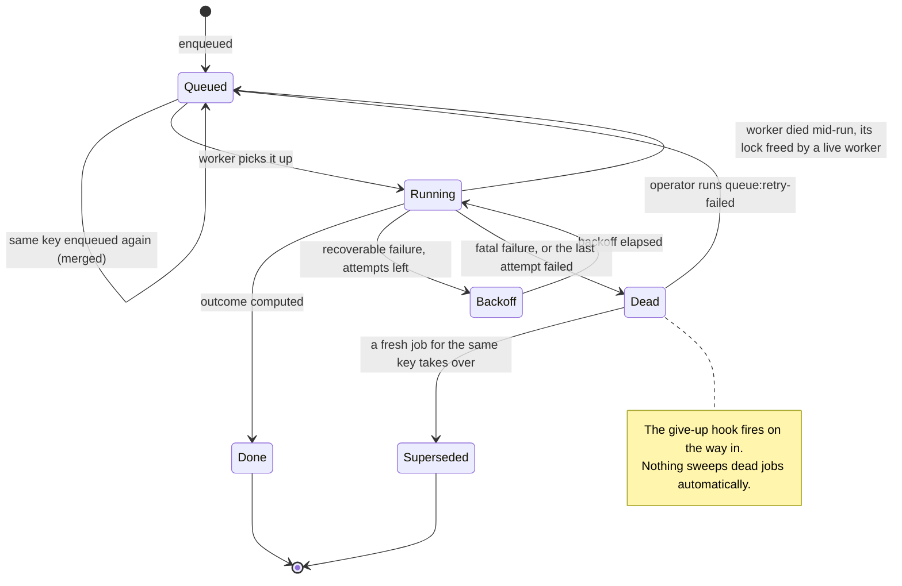
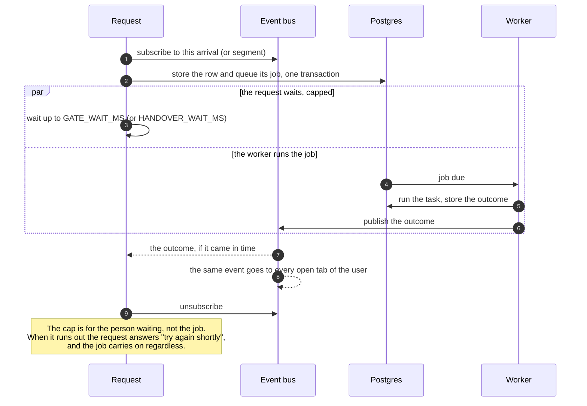
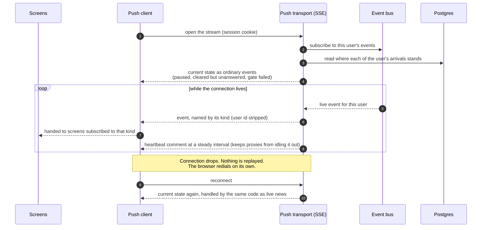
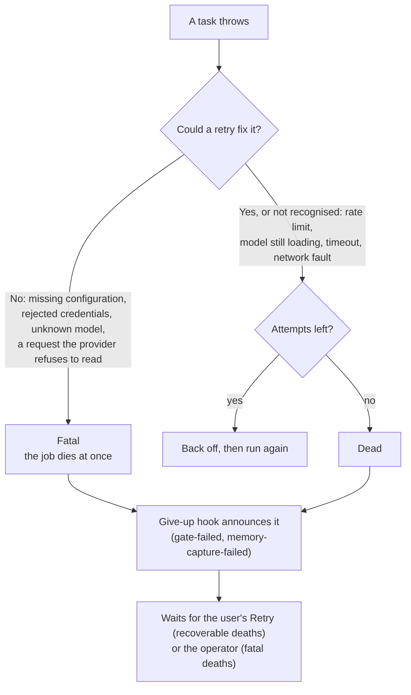

# Background work: the queue, the bus, and push

How work that must finish even after a request ends gets done, how the
results reach the people waiting for them, and what happens when things
go wrong. The decisions behind this live in ADR 0011 (queue), ADR 0012
(bus and push) and ADR 0013 (toggles). The code is the source of truth.
This page is the map, and it stays at the level of concepts that change
rarely.

For how a chat message travels through all of this, see
[new-message.md](new-message.md).

## 1. The moving parts

Work flows **down** through the queue, and news flows **up** through the
bus. Postgres is the only record. The queue lives beside the app's
tables, in its own `queues` schema. The bus keeps nothing: it only
carries news from the moment it happens to whoever is listening.

The worker runs inside the API process by default, as on the home
server, which is the shape drawn here. It can also run as a process of
its own, with any number of API and worker copies side by side; they
then share news and stops through Valkey. Only the two entry points
start the worker, so choosing between the shapes is configuration.
[aws-prod-architecture.html](../architecture/aws-prod-architecture.html) shows that
split shape as deployed.

### Where each part runs

| Part | Runs in | Its job |
|---|---|---|
| Screens | Frontend | Subscribe to the event kinds they show, keep only the ones for their Thread, then re-read from the API. An event says *something changed*; the API says *what*. |
| Push client | Frontend | Owns the tab's single connection, hands each event to the screens subscribed to its kind, and hides reconnects from them. |
| Requests | Backend | Store rows and enqueue work. The chat request and the Handover also wait on the bus for a result. |
| Worker | Backend | Runs tasks. Each task's flow publishes the outcome to the bus. |
| Event bus | Backend, in memory | Hands each event to every subscriber that wants it, at once, and keeps nothing. |
| Push transport | Backend | One stream per tab. Forwards only its user's events, strips the user id, and re-emits the current state whenever a tab connects. |
| Postgres | Database | The only record: the app's tables and the queue. |

### One event, end to end

This follows a single verdict across the frontend, the backend and
Postgres. The same event reaches two listeners: the request that is
waiting for it, and every open tab of the user.

The browser therefore holds two streams that are easy to confuse. The
reply streams back on the chat request that asked for it and ends with
the reply. The push stream stays open for the life of the tab and
carries news that lands later, such as a verdict that arrived after the
chat request stopped waiting, or a Thread's new title.

## 2. The queue

### What runs on it

A task is work the user should not have to wait for, or work whose loss
would leave the data owing something. The Exchange itself is not a
task. It streams to the person who asked and ends when they leave.

| Task | Works on (its key) | Queued when | Announces |
|---|---|---|---|
| **Drift gate: judge arrival** | one arrival | a message is submitted or an edit forks, in the same transaction as the row; a retry finds no judgment under way | the verdict (clear or paused), or that the gate failed |
| **Drift gate: fold Turn** | one completed Turn | a reply settles, completing its Turn | nothing; the next judgment folds inline whatever this task has not written yet |
| **Thread: generate title** | one Thread | the first Exchange completes on an untitled Thread; the user asks for a new title | the title |
| **Memory: capture segment** (only while Memory is on) | one segment | a drift fire closes a segment; a Handover finds no capture under way | the capture landed, or gave up |

Task names are prefixed with the feature that uses them, so they group
by feature in the code and in the queue tables alike.

### Anatomy of a task

Every task splits its work into two halves.

- **Enqueue side.** The trigger calls an ordinary async function that it
  was handed from the top of the call chain, so the code beneath never
  knows a queue exists. The job carries only identifiers. The task looks
  everything else up when it runs, so its input can never go stale.
- **Task.** Computes an outcome and nothing more. It announces nothing
  and queues nothing. A target that has vanished (a deleted Thread, an
  abandoned arrival) is a normal outcome, never an error.
- **Flow.** Turns the outcome into consequences: it publishes events
  and queues follow-up work. For example, a fire that closes a segment
  queues that segment's capture *before* the pause is announced, so the
  capture is already waiting by the time anyone reacts.
- **Give-up hook.** When a job will not run again on its own, its flow
  announces that too. Someone waiting on a result always hears an
  answer, even when the answer is "it failed".

### Life of a job

A job gets a few attempts, with exponential backoff. A dead job stays
visible until someone acts on it. A user's Retry re-queues a judgment
that failed with recoverable errors. A fatal failure waits for the
operator, who fixes the cause and runs `npm run queue:retry-failed`.
The script leaves replaced jobs alone, because newer work has already
replaced them.

### Exactly once, in effect

Three layers keep repeated requests from turning into repeated work:

1. **Merged at the door.** A job queued while an identical one (same
   task, same key) is still waiting merges into it. Asking twice
   queues once.
2. **Idempotent by state.** Correctness does not rest on the merge.
   Every task re-reads what is already stored and does only what is
   still owed. Running it twice changes nothing the second time unless
   the world changed in between. The Drift gate replays stored verdicts
   and never re-embeds or re-judges.
3. **Optimistic per Thread.** Two passes over one Thread (two
   judgments, or two captures) may overlap, and nothing makes them wait
   for each other. Each does all its inference first, holding no
   database connection, then writes its results in one short
   transaction that succeeds only if no other pass wrote first. The
   loser reads what the winner stored and reports that, as a pass that
   finds its work already done always has. A rewrite or embedding a
   judgment stores before reaching its verdict is kept only if none is
   stored yet, so overlapping judgments reach their verdict on the same
   inputs. The loser's inference was still paid for, so its spend is
   added to the record. Overlap is rare, so an occasional duplicate
   round of inference costs far less than holding a connection through
   every pass. All of this lives in the database, so it holds wherever
   the worker runs.

## 3. The event bus

The bus is a publish/subscribe channel. Every event names the user it
is for and, where it has one, its Thread. Producers never know who is
listening. Inside one process it delivers at once. With Valkey
configured, it also carries each user's events, on a channel of that
user's own, to the other backend copies listening to them, and a
user's stop to whichever copy runs the Exchange.

- **Lost news is caught by reading again.** Between copies, delivery is
  at most once. A chat waiting on its verdict, or a Handover waiting on
  its capture, reads the database once it is sure to hear the news, and
  once more when its wait runs out.

- **Nothing is kept.** A subscriber that arrives late never sees an
  earlier event. The database stays authoritative, and the bus is only
  for convenience.
- **One bad listener cannot spoil delivery.** A subscriber that throws
  is logged and skipped, and the rest still get the event.

| Event | Means | Who listens |
|---|---|---|
| `verdict-ok` | the gate judged an arrival clear | the waiting chat request, every tab of the user |
| `verdict-paused` | the gate fired, and the arrival waits for the user's choice | the waiting chat request, every tab of the user |
| `gate-failed` | the gate gave up on an arrival | the waiting chat request, every tab of the user |
| `thread-titled` | a Thread received its title | every tab of the user (thread list) |
| `memory-captured` | a segment's Facts were captured | a waiting Handover |
| `memory-capture-failed` | a capture gave up, and its Facts stay owed | a waiting Handover |

### Waiting on a result: listen first, then ask

A request that needs a background result does not poll. It subscribes
to the bus *before* the job can possibly finish, then checks the stored
state, and only then waits. That ordering means a result that lands
between "check" and "wait" can never slip past. The chat request
waiting for a verdict and the Handover waiting for a capture both work
this way.

When the wait runs out, or the browser goes away mid-wait, only the
wait ends. The job finishes, the outcome is stored, and the event still
reaches any tab that is open.

## 4. Push to the browser

Each tab holds one long-lived connection to `GET /api/events`,
authenticated by the same session cookie as every other request. The
transport is an adapter: SSE today, possibly WebSockets later. Swapping
it touches only the transport and its browser-side counterpart.

On the browser side:

- **Per user, not per Thread.** The server keeps no record of which
  Thread a tab is showing. Every tab gets all of its user's events, and
  each screen keeps only the ones for what it displays.
- **Screens react by re-reading.** The open chat view reloads its
  Thread when a verdict for that Thread arrives. The thread list
  updates a title when `thread-titled` arrives.
- **Losing push only costs promptness.** A tab without a working
  connection sees the same state on its next load or focus, and the
  server still refuses whatever that state forbids.

## 5. When things fail

### Inside the queue: recoverable or fatal

Every task failure is classified in one place.

An unrecognised error counts as recoverable, so it uses its remaining
attempts before giving up.

### What the user sees

One table for every way a chat can fail to produce a reply. Clients
receive a stable `errorCode` and a curated message, never raw provider
details, which stay in the server log. The browser decides what to show
from the code, not the HTTP status.

| Situation | Server answers | Browser shows | How it resolves |
|---|---|---|---|
| Verdict not in within `GATE_WAIT_MS` | 503 `gate_pending`, `Retry-After` | the message stays, with "still being checked" and Retry | the verdict lands by push and the notice updates; Retry then replies without re-judging |
| Gate gave up after recoverable failures | (seen on the next Retry) | as above | Retry queues a fresh judgment and waits again |
| Gate gave up fatally | 503 `gate_failed`, plus `gate-failed` on every reconnect | "couldn't check this message", with Retry | the operator fixes the cause and runs `queue:retry-failed` |
| Browser closed mid-wait | only the wait ends | on return, the connect snapshot shows the arrival's state | Retry; an arrival nobody is watching never gets a reply, so nothing is spent on it |
| Gate fired | the stream carries only the verdict, then ends | a choice: continue here, or start a new chat | the user decides (see new-message.md) |
| Handover while the old segment's capture runs | 503 `capture_pending`, nothing moved | "Remembering this chat…", and asks again automatically | the capture lands (the Seed includes it) or gives up (the move goes ahead, Facts stay owed) |
| New message while the last arrival is unanswered or paused | 409 `arrival_unanswered` / `arrival_paused` | composer locked, pointing at Retry or the choice | answer the waiting arrival first |
| The arrival was answered by another request, or edited away, during the wait | 409 `arrival_answered` / `arrival_abandoned` | error notice; the message stays as stored, no draft comes back | none: the Thread already shows what became of it |
| An Exchange is already running | 409 `exchange_in_flight` | error notice | a pending reply older than `EXCHANGE_STALENESS_MS` belongs to a dead process and is settled as interrupted on the next start |
| Daily spend budget reached | 429 `budget_exceeded`, `Retry-After` until UTC midnight | error notice | wait for the next UTC day |
| No AI provider configured | 503 `provider_not_configured` | error notice | fix the deployment's configuration |
| Exchange stopped, timed out, or errored mid-stream | the stream ends | the partial reply stays visible | the partial reply and its estimated spend are kept, and the user can Retry |

### Containment

- **No attempt runs forever.** Every attempt has the same time limit.
  One that runs past it fails as recoverable, with a warning in the log,
  and the job is retried like any other failure. The overrun work is not
  cancelled, only no longer waited for.
- **A crash mid-task loses nothing.** Because live workers end every
  attempt within the time limit, a job locked well beyond it belongs to
  a worker that crashed or froze: any running worker releases it and it
  runs again. Because every task checks the current state before acting,
  re-running half-done work is safe. Tasks must stay idempotent for both
  rules to hold.
- **News failures stay contained.** A listener that throws, or a
  give-up hook that fails, is logged without affecting the job or other
  listeners. If the connect-time snapshot fails, the stream still
  delivers live events.
- **Push failures never corrupt anything.** Push carries only news, so
  a lost event costs promptness at most. The next load reads the truth
  from the database.

## 6. Known limits

- **Several copies need Valkey.** Without it, news and stops stay
  inside one process, so the API and the worker run together. With it,
  a stop lost between copies lets that Exchange run to its end.
- **No automatic sweep.** Dead jobs wait for a Retry or the operator.
  There is no management screen yet.
- **Toggles are read at boot.** Memory's capture task exists only while
  Memory is on. Capture jobs queued before it was switched off stay
  queued, untouched, and run once it is back on and the backend has
  restarted.
